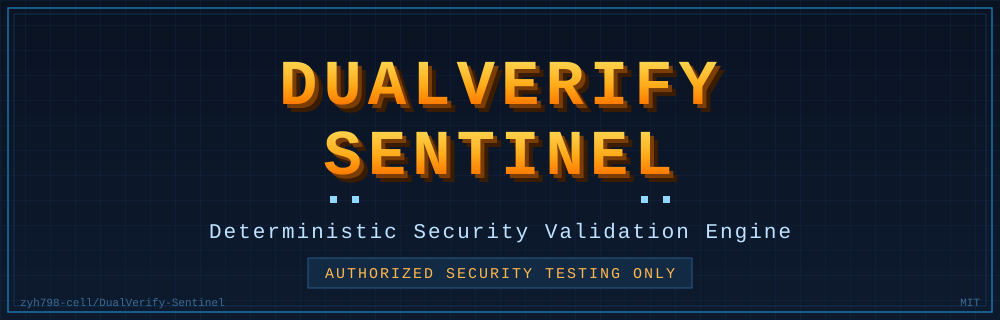

<div align="center">


# DUALVERIFY-SENTINEL

### ENGINEERED FOR TRUST.
### BUILT FOR CONTROL.

**明示的な認可、決定論的な実行、検証可能な証跡を中心に据えたポリシー駆動のセキュリティ検証エンジン。**

決定論的な実行 · 明示的な認可境界 · 監査可能なセキュリティ証跡。

`zyh798-cell` / `DualVerify-Sentinel` · MIT



[](https://github.com/zyh798-cell/DualVerify-Sentinel)
[](https://github.com/zyh798-cell/DualVerify-Sentinel)
[](https://www.python.org/)
[](../../LICENSE)
[](#7-プラットフォーム互換性とコミュニティテスト)
[](#3-要件)
[](#5-認可と安全性)
[](#8-プロジェクトの状態と方向性)

[English](../../README.md) · [中文](README.zh-CN.md) · **日本語** · [한국어](README.ko.md) · [Español](README.es.md) · [Français](README.fr.md)

[概要](#1-dualverify-sentinel-とは) · [実装機能](#2-現在実装されている機能) · [クイックスタート](#4-インストールとクイックスタート) · [認可と安全性](#5-認可と安全性) · [プラットフォームテスト](#7-プラットフォーム互換性とコミュニティテスト) · [参加・貢献](#9-参加とコントリビューション) · [Security](../../SECURITY.md)

> ⭐ **本プロジェクトが役に立つなら Star をお願いします。コミュニティによるテストと貢献も歓迎します。**

> ⚠️ **認可されたセキュリティテストのみ**

</div>

---

## 1. DualVerify-Sentinel とは

DualVerify-Sentinel（DVS）は**ポリシー駆動のセキュリティ検証エンジン**です。すべての実行ステップは機械可読な認可スコープに対して検査され、改ざん検知可能な証跡ジャーナルに記録され、**フェイルクローズ**で動作します。認可の欠落・破損・期限切れはチェックのスキップではなく、拒否となります。

これはセキュリティエンジニアリングの基盤層、つまり認可ゲートと決定論的実行エンジンです。Gen-1 の計画層は**静的なルールベースのテンプレート**であり、モデル駆動・適応型のプランナーではありません。

**現時点の DVS ではないもの**：汎用エージェント基盤、LLM エージェントランタイム、モデル駆動の自律判断システム、OS レベルのサンドボックス。これらは長期的な方向性であり、現在の機能ではありません。

## 2. 現在実装されている機能

以下の機能はモデル判断ではなく、明示的なコードパスによって強制されます。

| 機能 | 実装内容 |
|---|---|
| **明示的な認可** | スコープ JSON を**独立サブプロセス**で検証。実行時にスコープハッシュ・モード・対象・時間枠を改めて独立検証。欠落・破損・期限切れ → 拒否。回避経路は存在しません。 |
| **ポリシー駆動の実行** | リスク上限が段階的に上がる 5 モード：`passive`(R0)、`safe_scan`(R1)、`vuln_validation`(R2)、`attack_simulation`(R3)、`high_risk`(R4)。明示的な決定ルールにより、拒否・中止・失敗でループを停止し、対象範囲は拡大されません。 |
| **リスクを考慮した制御** | TaskGraph ステートマシンにハード上限（最大 32 ノード、派生深度 2、派生 8 回）、親ノード COMPLETED を条件とする動的派生、ステップごとの 12 段階チェーン。破壊的手法・永続化・ペイロード生成・発見データの外部送信は行いません。 |
| **セキュリティツール連携** | コアアダプタ `nuclei` / `bandit`、および `vuln_hunter/adapters_ext/` の任意アダプタ `gitleaks` / `semgrep`（ローカルルールファイルのみ、ネットワークからルールを取得しません）。出力は統一 Finding Schema（`findings.py`）で正規化。バイナリが無い場合は事前レポート付きで安全にスキップします。 |
| **検証可能な監査証跡** | 追記のみの SHA-256 ハッシュチェーン（`seq` / `prev` / `h`）で改ざん・並べ替えを検知。監査失敗は終了コード 3 で明示され、未認証の結果を正常結果として見せません。 |
| **誠実で構造化されたレポート** | 検出結果はそのまま記録し、未検証のツール出力を確認済み脆弱性として扱いません。既知の制限を毎回記載し、検出精度や正解率の主張は行いません。 |

> アダプタは**コードとして実装されています**。コードの存在は実ツールの実行検証の証拠ではありません。実ツールのエンドツーエンド検証は未完了です（第 8 節参照）。

## 3. 要件

| 項目 | 内容 |
|---|---|
| Python | >= 3.10（3.13.14 で検証） |
| 依存関係 | **標準ライブラリのみ** — サードパーティ製ランタイム依存なし |
| OS | Windows **検証済み**；Linux / macOS **未検証** — 第 7 節参照 |
| 任意の外部ツール | `nuclei`、`bandit`、`gitleaks`、`semgrep` — 無い場合は安全にスキップ |

## 4. インストールとクイックスタート

```bash
git clone https://github.com/zyh798-cell/DualVerify-Sentinel.git
cd DualVerify-Sentinel

python -m venv .venv
# Windows (PowerShell): .venv\Scripts\Activate.ps1
# Windows (CMD):        .venv\Scripts\activate.bat
# Linux/macOS:          source .venv/bin/activate

pip install .
```

開発用には `pip install -e .` も利用できます。

**ステップ 1 — 必ず最初にスコープファイルを検証：**

```bash
dvs gate-check scripts/example-scope.json
# 0 = 有効 · 1 = 拒否 · 2 = 用法エラー
```

**ステップ 2 — 検証を実行：**

```bash
dvs run --scope scripts/example-scope.json --mode safe_scan --target 127.0.0.1:8080
# または: python -m vuln_hunter run --scope ... --mode ... --target ...
```

モード（リスク上限の昇順）：`passive` → `safe_scan` → `vuln_validation` → `attack_simulation` → `high_risk`（R0–R4）。`nuclei` は R2 以上でのみ呼び出されます。

終了コード：`0` 全ステップ完了 · `1` 失敗/拒否ありで終了 · `2` ゲート/ポリシーによる拒否（何も実行しない） · `3` **監査失敗**（ジャーナルが書込み不能または検証不能のため、結果は認証されません）。

`scripts/example-scope.json` は架空の例であり、**実際の認可ではありません**。

## 5. 認可と安全性

> ⚠️ **DVS は、自身が所有・運用するシステム、ローカル実験環境、または所有者から明示的な書面による認可を得たホストに対してのみ使用してください。**

未認可・範囲外・期限切れ・破損した設定は拒否されます。認可をスキップするコードパスは存在しません。

- エントリは**パース済みホスト名の一致**で照合されます。ポート指定がないエントリはそのホストの全ポートに一致します。**CIDR 範囲は非対応** — `host` または `host:port` を使用してください。
- 認可の時間枠は**すべての実行ステップ**で再確認され、実行中の期限切れは以降のステップを中止します。
- スコープ内容はハッシュとして各実行チケットに束縛され、スコープ変更で未使用チケットは無効化されます。
- ファイルシステム範囲のステップはネットワーク範囲チェックのみをスキップし、他のポリシーチェックはすべて適用されます。

実際の認可記録は本リポジトリ外に保管してください。同梱の例は架空のものです。

**API 強化は OS レベルのサンドボックスではありません。** `RunTicket` の frozen dataclass とプライベートレジストリは Python レベルの強化であり、プロセス内の悪意あるコードは回避できます。強力な分離にはプロセスレベルの措置が必要で、これは未実装です。サポートされる入口は CLI のみです。

## 6. 証跡と誠実なレポート

監査ジャーナルは追記のみ・ハッシュチェーン付きで、改ざんや並べ替えを検知します。監査失敗は隠蔽せず明示されます。実行レポートは完全・部分・不完全を区別し、不完全な結果はフェイルクローズとなり検出結果として採用されません。

2 つの境界を明記します。ツール出力はそのまま記録され、未検証の出力が確認済み脆弱性に格上げされることはありません。また、ジャーナル末尾の切り詰めは、外部に head アンカーが保存されている場合にのみ検知できます。

## 7. プラットフォーム互換性とコミュニティテスト

**コミュニティによるテストを歓迎します。プラットフォーム互換性の拡大にご協力ください。**

DVS は現在 **Windows 優先**です。Windows のタイムアウト経路では、記録付きのプロセスツリー洗浄（ルート終了前に `taskkill /T /F` を実行し、各結果を記録）を行います。管理された演習で確認済みですが、残留プロセスが絶対に無いことを保証するものではありません。非 Windows ではツリー終了がスキップされ、ルートプロセスのみ終了します。`nuclei` のパスフォールバックも特定のローカル配置を前提とします。

Linux と macOS は**未検証**で、CI もまだ対象にしていません。他プラットフォームで動作させた場合は、動作した点・しなかった点を issue で共有してください。アダプタ挙動、プロセス洗浄、パッケージングは特に有用です。実ターゲットのデータ、認証情報、未認可のスキャン出力は添付しないでください。

## 8. プロジェクトの状態と方向性

| | |
|---|---|
| **実装済み（Gen-1）** | 認可ゲート、ポリシーエンジン（R0–R4）、TaskGraph、監査ジャーナル、構造化レポート、統一 Finding Schema、および `nuclei` / `bandit` / `gitleaks` / `semgrep` アダプタのコードパス。 |
| **構築・検証中** | 実ツールのエンドツーエンド検証、非 Windows 検証と CI、現バージョンのパッケージング検証。テストスイートは `tests/` にあります。実際に実行し、その出力を根拠としてください。本リポジトリは「全て成功」を事前には主張しません。 |
| **長期的な方向性** | モデル駆動の計画、より強いプロセスレベル分離、より広いプラットフォーム対応。いずれも方向性のみで、Gen-1 には**未実装**です。 |

現在の計画層は決定論的な静的テンプレートです。アダプタのコード存在はツール実行の検証を意味せず、API 強化は OS レベルのサンドボックスではありません。パッケージングは現バージョンを実際にビルドして判断する必要があり、古いビルド成果物は現バージョンの証拠になりません。これはエンジニアリング基盤であり、本番運用可能な評価製品ではありません。

## 9. 参加とコントリビューション

Star はプロジェクトを見つけてもらう助けになります。自身の実験環境での試用、気付いた点の報告、Pull Request の作成も歓迎します。詳細は [CONTRIBUTING.md](../../CONTRIBUTING.md) を参照してください。

参加できる領域：

- **プラットフォーム適応と互換性テスト** — Linux/macOS の挙動、プロセスツリー洗浄、パッケージング。
- **セキュリティツールの Provider / Adapter 統合** — 認可ゲートとフェイルクローズ設計を守る新規連携。
- **テストケースと回帰ベースライン** — 再現可能で証跡を残すチェック。
- **ドキュメントと翻訳** — 6 言語の README、例、読みやすさ。
- **バグ修正とコード品質** — 実行可能な証拠を添えた、小さく焦点を絞った変更。
- **セキュリティ研究** — [SECURITY.md](../../SECURITY.md) に従ってください。未公開の脆弱性を公開 issue にしないでください。
- **利用体験と機能提案** — まず issue で範囲を合意してください。

バグ・プラットフォーム結果・提案には **Issues**、コードとドキュメントの変更には **Pull Requests** を使用してください。実ターゲットのデータ、認証情報、私有の認可記録、未認可のスキャン出力を issue や PR に添付しないでください。

## 10. ライセンスとリンク

- **ライセンス**：MIT — [LICENSE](../../LICENSE) を参照。
- **セキュリティポリシー**：[SECURITY.md](../../SECURITY.md)。
- **コントリビューションガイド**：[CONTRIBUTING.md](../../CONTRIBUTING.md)。
- **Issues / PR**：[issue を作成](https://github.com/zyh798-cell/DualVerify-Sentinel/issues) · [PR を作成](https://github.com/zyh798-cell/DualVerify-Sentinel/pulls)。
- **翻訳**：中文 · 日本語 · 한국어 · Español · Français（上部の言語切替を参照）。

---

<div align="center"><sub>DualVerify-Sentinel · Engineered for Trust. Built for Control. · MIT © 2026 zyh798-cell</sub></div>
