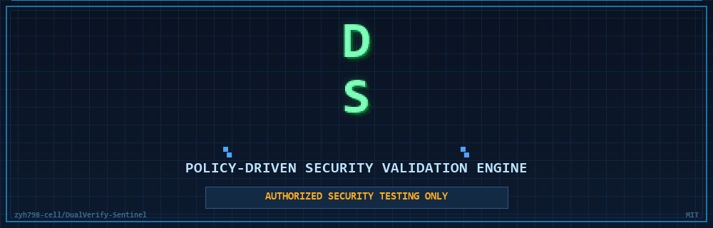

<div align="center">


# DUALVERIFY-SENTINEL

### ENGINEERED FOR TRUST.
### BUILT FOR CONTROL.

**ポリシー駆動のセキュリティ検証エンジン**

決定論的な実行。明示的な認可境界。監査可能なセキュリティ証跡。

`zyh798-cell` / `DualVerify-Sentinel` · MIT



[](https://www.python.org/)
[](../../LICENSE)
[](#4-要件)
[](#4-要件)
[](#8-認可と安全性)
[-2EA043)](#11-プロジェクトの状態)

[English](../../README.md) · [中文](README.zh-CN.md) · **日本語** · [한국어](README.ko.md) · [Español](README.es.md) · [Français](README.fr.md)

[認可ゲート](#認可ゲート) · [ポリシーエンジン](#ポリシーエンジンとリスクラダー) · [TaskGraph](#taskgraph-オーケストレーション) · [ツールアダプタ](#ツールアダプタ-nuclei--bandit) · [監査ジャーナル](#監査ジャーナル) · [レポート](#構造化レポート) · [インストール](#5-インストール) · [セキュリティ](../../SECURITY.md)

> ⚠️ **AUTHORIZED SECURITY TESTING ONLY**

</div>

---

## 1. これは何か

DualVerify-Sentinel は**ルールベースのセキュリティ検証エンジン**です
（明示的に**モデル非駆動**）：すべての実行ステップは機械可読な認可スコープに
対してポリシーチェックされ、改ざん検知可能なハッシュチェーンの監査ジャーナルに
記録され、**フェイルクローズド**で動作します — 認可の欠落・破損・期限切れは
*拒否*を意味し、チェックの省略ではありません。

次世代検証アーキテクチャ（認可ゲート + 信頼性の高い実行エンジン）の
セキュリティエンジニアリング基盤層です。Gen-1 の計画/決定層は意図的に
決定論的に保たれています。

## 2. 何ができるか

Gen-1 は単一の決定論的パイプラインとして動作します — 以下の各機能はモデル判断ではなく、明示的なコードパスによって強制されます。

### 認可ゲート

機械可読な scope JSON を**独立サブプロセス**で検証。欠落/破損/期限切れ → REFUSED（終了コード 2）。バイパス経路は存在しません。アダプタはポリシーエンジン発行のチケットのみ受諾。スコープハッシュ・モード・ターゲット・ウィンドウを**実行時に再独立検証**します。

### ポリシーエンジンとリスクラダー

リスク上限が昇順の 5 モード（R0–R4、[基本的な使い方](#6-基本的な使い方)参照）。明示的ルール P0–P8：拒否/中断/失敗があればループ停止。ターゲットは**決して**拡大しません。

### TaskGraph オーケストレーション

ハード予算つきステートマシン（最大 32 ノード、スポーン深度 2、8 スポーン）。動的スポーンは親の COMPLETED を前提条件とします。

### ツールアダプタ (nuclei / bandit)

`nuclei`（テンプレートスキャン）と `bandit`（静的解析）— 未インストール時は preflight レポート付きで SKIPPED。安全な実行：ステップごとに 12 項目のチェックチェーン。破壊的技術なし、永続化なし、ペイロード構築なし、発見データの外部送信なし。

### 監査ジャーナル

追加専用ハッシュチェーン（`seq`/`prev`/`h`、SHA-256）。改ざん/並べ替え検知。監査障害は終了コード 3 で終了し、通常結果として偽装しません。

### 構造化レポート

発見内容はそのまま記録。未検証の出力が確認済み脆弱性として標識されることはありません。既知の制限はレポートごとに列挙されます。

## 3. ユースケース

- 自分のラボターゲットや明示的に認可されたホストの検証。
- 完全な監査証跡を持つ、再現可能でエビデンスを生成するセキュリティチェック。
- より高度な検証パイプラインの基盤層として。

## 4. 要件

| 要件 | 詳細 |
|---|---|
| Python | >= 3.10（3.13.14 のみでテスト済み） |
| サードパーティ依存 | **なし** — 標準ライブラリのみ |
| OS | Windows **検証済み**、Linux/macOS **未検証** |
| 外部ツール（任意） | `nuclei`、`bandit` — 無ければスキップ |

## 5. インストール

```bash
git clone https://github.com/zyh798-cell/DualVerify-Sentinel.git
cd DualVerify-Sentinel

python -m venv .venv
# Windows (PowerShell):
.venv\Scripts\Activate.ps1
# Windows (CMD):
.venv\Scripts\activate.bat
# Linux/macOS:
source .venv/bin/activate

pip install .
```

開発用には編集可能インストール `pip install -e .` も利用できます。

## 6. 基本的な使い方

**ステップ 1 — scope ファイルの検証（必ず最初に）：**

```bash
dvs gate-check scripts/example-scope.json
# 終了コード 0 = スコープ有効 · 1 = 拒否
```

**ステップ 2 — 検証の実行：**

```bash
dvs run --scope scripts/example-scope.json --mode safe_scan --target 127.0.0.1:8080
# または: python -m vuln_hunter run --scope ... --mode ... --target ...
```

モード（リスク上限の昇順）：`passive` → `safe_scan` → `vuln_validation` →
`attack_simulation` → `high_risk`（R0–R4）。`nuclei` は R2 以上でのみ呼び出されます。

終了コード：`0` 全ステップ COMPLETED · `1` 失敗/拒否ありで完了 ·
`2` ゲート/ポリシーレベルの拒否（何も実行されず） · `3` **監査障害**
（ジャーナルが書き込めない/検証できない — 結果は保証されません）。

`scripts/example-scope.json` は架空の例であり、**実在の認可ではありません**。

## 7. スコープのセマンティクス

- エントリは**パース済みホスト名の一致**で判定されます（ポートなしのエントリは
  そのホストの任意のポートに一致）。**CIDR 範囲は非対応** — `host` または
  `host:port` 形式を使用してください。
- 認可ウィンドウは**実行ステップごとに**再チェックされ、実行中の期限切れは
  以降のステップを中止します。
- スコープ内容のハッシュは各実行チケットにバインドされ、スコープ変更は
  未完了チケットを無効化します。
- ファイルシステムスコープのステップはネットワークスコープチェックのみを
  スキップし、その他のポリシーチェックは通常どおり適用されます。

## 8. 認可と安全性

> ⚠️ **本ツールは、自分が所有・運営するシステム、ローカルラボターゲット、
> または所有者から明示的な書面による認可を得ているホストに対してのみ使用して
> ください。** 未認可・範囲外・期限切れ・破損した設定は拒否されます
> （フェイルクローズド）。認可をスキップするコードパスは存在しません。

同梱のサンプルスコープは架空のものです。実際のエンゲージメントには実在の、
機械可読な認可記録が必要です — リポジトリの外で保管してください。

## 9. API 強化はサンドボックスではない

RunTicket の frozen dataclass とプライベートレジストリは **API 強化**であり、
サンドボックスではありません — 敵対的なプロセス内コードはあらゆる
Python レベルのチェックを回避できます。強固な分離にはプロセスレベルの対策が
必要です（未実装）。CLI が唯一のサポート対象エントリポイントです。

## 10. 既知の制限

1. **プロセス内サンドボックスなし** — セクション 9 を参照。
2. **Windows 優先** — Windows のタイムアウト経路には実装済みのプロセスツリー
   クリーンアップがあります（ルート kill の前に `taskkill /T /F` を実行し、
   全結果を記録）。管理された 3 層プロセスツリー訓練で検証済みですが、
   **絶対的な保証ではありません** — ランタイムの残存確認はなく、taskkill の
   rc=0 はツリー全体の消去完了を証明せず、実 Nuclei の子孫プロセス形態は
   未検証です。非 Windows ではツリー kill をスキップします（ルートのみ kill）。
   nuclei のパスフォールバックは特定の `~/Tools/nuclei/` レイアウトを想定し
   ています。
3. **検出の正確性は保証しない** — ツール出力はそのまま記録され、未検証の
   結果が確認済み脆弱性として標識されることはありません。
4. **Linux/macOS 未検証** — CI は非 Windows プラットフォームをカバーしません。
5. **ジャーナル末尾の切り詰め** — 外部に head アンカーを保存した場合のみ検知
   可能。レポート内アンカーは整合性確認用です。
6. **Gen-1 プランナーは静的テンプレート** — 計画は決定論的であり、
   モデル駆動でも適応的でもありません。

## 11. プロジェクトの状態

- **Gen-1 は安定**：18 のオフラインテストスイート、427+ チェックがローカルで
  合格（Windows、Python 3.13.14）。wheel/sdist ビルドによるパッケージング
  スモークテスト済み。
- **Gen-2 アーキテクチャ**（将来の独立リポジトリ）を計画中。
  提案/裁定の分離を導入予定。Gen-2 の作業はこのリポジトリでは行いません。
- 完全なテストコマンドは `tests/` 配下を参照 — 実行して実際の結果を信頼して
  ください。このリポジトリは事前の「オールグリーン」主張を行いません。

## 12. ライセンスとフィードバック

- **ライセンス**：MIT — [LICENSE](../../LICENSE) を参照。
- **セキュリティポリシー**：[SECURITY.md](../../SECURITY.md) を参照。
- **コントリビューション**: [CONTRIBUTING.md](../../CONTRIBUTING.md) を参照。
- Issue と Pull Request を歓迎します。セキュリティ関連の報告は、公開 issue を
  作成せず SECURITY.md のガイダンスに従ってください。

---

<div align="center">
<sub>DualVerify-Sentinel · Deterministic Security Validation Engine · MIT © 2026 zyh798-cell</sub>
</div>
